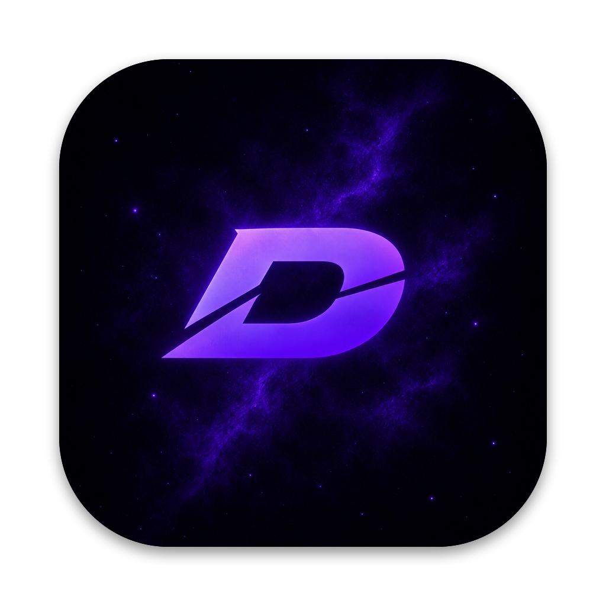

# DROP by TONY CARLOS

<p align="center"></p>

**DROP by TONY CARLOS** est une app macOS gratuite pour les beatmakers sous FL Studio : tu glisses un projet `.flp`,
elle retrouve tous les samples audio utilisés (`.wav`, `.mp3`, `.aif`, `.aiff`, `.flac`, `.ogg`),
les classe par type (808, kick, snare, clap, hihat…) et les **copie** dans un dossier propre, renommés.
Idéal pour préparer un drum kit ou envoyer les sons d'une prod.

```
<dossier de sortie>/<type>/<type>-<artiste>-<titre>.<ext>
Sorties/808/808-wazanolimit-monalisa.wav
Sorties/clap/clap-wazanolimit-monalisa.wav
```

Chaque type a **un seul dossier** qui se remplit au fil de tes prods : tous tes claps finissent dans `clap/`,
chacun avec le nom de l'artiste et du morceau. Rien n'est jamais écrasé.

Les copies sont **nettoyées** : toutes les infos attachées au fichier (titre, artiste, commentaires, image,
icône personnalisée, étiquettes, lien de téléchargement…) sont retirées, le son reste identique.
Formats nettoyés : WAV, MP3, AIFF, FLAC (les OGG sont copiés tels quels).

- 100 % local : aucune connexion internet nécessaire.
- Les fichiers originaux ne sont jamais déplacés ni modifiés.
- Fonctionne aussi avec des projets venus d'un autre ordinateur (chemins Windows, disque externe débranché…).

## Télécharger

👉 **[Télécharger la dernière version](../../releases/latest)** : prends `DROP-x.y.z.dmg`.

1. Ouvre le `.dmg` et glisse **DROP** dans **Applications**.
2. **Première ouverture** : l'app n'est pas signée par Apple, donc macOS la bloque par défaut.
   Fais **clic droit sur DROP → Ouvrir → Ouvrir**. Ensuite elle s'ouvre normalement.
   Si le message persiste : Réglages Système → Confidentialité et sécurité → « Ouvrir quand même ».
3. macOS demandera l'accès à Téléchargements / Documents / disques externes : accepte, c'est pour trouver tes sons.

Compatible macOS 14 et plus, Apple Silicon et Intel.

## Utilisation

1. Premier lancement : choisis ta bibliothèque de drums (modifiable dans les réglages, `⌘,`).
2. Glisse un ou plusieurs `.flp` dans la fenêtre (ou `⌘O`).
3. Vérifie la liste : décoche des sons, change le type en cliquant sur le badge coloré.
4. Remplis artiste, titre (vide = nom du `.flp`) et dossier de sortie.
5. Appuie sur **START** (ou Entrée). Un récapitulatif s'affiche à la fin.

Recherche des samples, dans l'ordre : chemin exact du `.flp` → bibliothèque → `~/Downloads` → dossiers de secours.
Sons introuvables : bouton « CHERCHER… » pour fouiller un autre dossier ou un disque externe.

## TUNING KITS : habiller un kit dans le Browser de FL Studio

Onglet **TUNING KITS** (en haut de la fenêtre) : une image **cover** pour le kit et une **bannière** sous chaque dossier
(Claps, Kicks, 808s…) ou chaque son, affichées dans le Browser de FL Studio.

1. Glisse le dossier principal du kit dans la fenêtre (ou clique pour le choisir).
2. Glisse la cover dans le grand carré, et une image sur chaque dossier (PNG/JPG, redimensionnée automatiquement :
   300 px de large pour les bannières, 256×256 pour la cover).
3. Appuie sur **START**.

Bannières automatiques : dans les réglages (`⌘,`), choisis un dossier où tu ranges tes bannières nommées
`808.png`, `kick.png`, `snare.png`, `clap.png`, `hihat.png`, `openhat.png`, `perc.png`, `rim.png`, `crash.png`,
`fx.png`, `vox.png`, `loop.png`, `autres.png`. DROP les propose pour les dossiers reconnus (Claps → `clap.png`).
Des images d'exemple sont dans [`image test/`](image%20test/).

DROP **ne touche jamais aux samples** : il ajoute seulement des fichiers `.nfo` et un dossier caché `.images`.
Un `.nfo` déjà présent n'est modifié qu'après confirmation (seules les lignes Tip, Bitmap et Color changent).
**RETIRER LE TUNING** supprime uniquement ce que DROP a ajouté et remet les `.nfo` d'origine.
Le format des `.nfo` se règle dans `Sources/DKWCore/Tuning/FLBrowserFormat.swift`.

## Outil en ligne de commande

```
dkw-flp projet.flp                       # liste les samples du .flp
dkw-flp projet.flp --library ~/Samples   # + vérifie s'ils sont retrouvés
dkw-flp --tune "Mon Kit" --banners "image test" --cover "ma-cover.png"   # habille un kit
dkw-flp --tune "Mon Kit" --remove        # retire ce que DROP a ajouté
dkw-flp --self-test                      # tests automatiques
```

## Construire depuis le code

Prérequis : Command Line Tools (pas besoin d'Xcode).

```
./build.sh
```

Produit `build/DROP.app`, `build/DROP-<version>.dmg`, `build/DROP-<version>.zip` et `build/dkw-flp`.

La détection des types se règle dans `Sources/DKWCore/Classification/ClassificationRules.swift`.
`Sources/DKWCore` contient toute la logique (lecture FLP, recherche, classification, copie) sans interface ;
`Sources/DROP` contient l'interface SwiftUI.

---

DROP by TONY CARLOS · logiciel pour beatmakers FL Studio sur Mac · extraction de samples · drum kit
